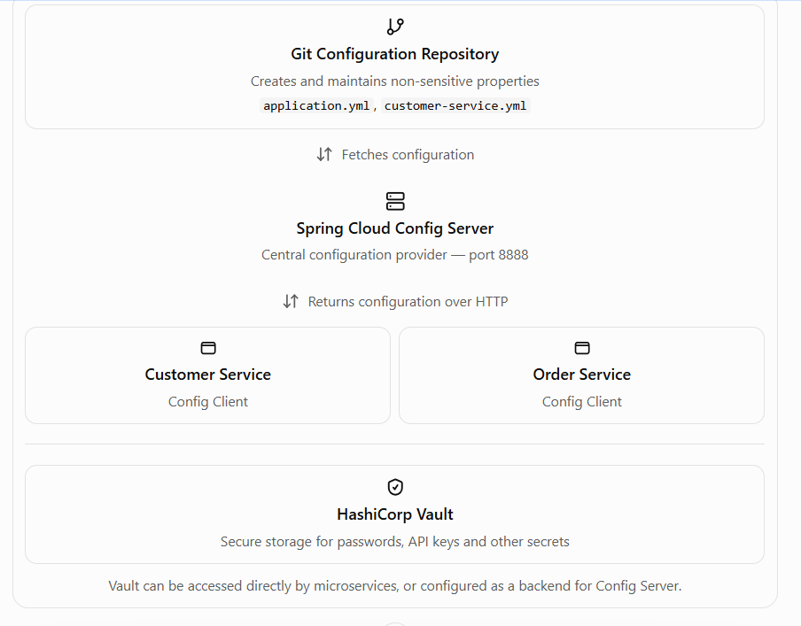

docker run --name local-vault `
  -p 127.0.0.1:8200:8200 `
-e VAULT_DEV_ROOT_TOKEN_ID=dev-only-token `
hashicorp/vault

vault token generated as Root token 
hashicorp/vault:latest 8200/tcp

docker logs latest-vault
docker inspect latest-vault --format '{{json .Config.Cmd}}'
docker inspect latest-vault --format '{{json .Config.Env}}'

Complete Notes: HashiCorp Vault + Spring Cloud Config Server + Config Client
Keerthi, let's build this from the ground up as study notes, using your Spring Boot microservices project as the example.

The easiest way to understand the whole concept is to separate it into three responsibilities:
- Vault: stores and manages sensitive secrets, such as passwords and API keys.
- Config Server: retrieves centralized configuration from a source such as Git or Vault and serves it to microservices.
- Config Client: consumes configuration from Config Server and makes it available to the Spring Boot application.
  One clarification: Config Server doesn't create properties by itself. You define properties in Git or Vault; Config Server retrieves and serves them. The Config Client consumes them.

There are two common ways to connect Vault:
1. Direct Vault pattern: Config Client retrieves normal configuration from Config Server and secrets directly from Vault.
2. Config Server Vault-backend pattern: Config Server retrieves configuration from Git and secrets from Vault, then serves the resulting configuration to clients.

Configuration	Values that control how an application behaves
Property	A key-value pair, such as app.timeout=30
Git repository	Version-controlled storage for configuration files
Config Server	Application that serves centralized configuration
Config Client	Application that fetches configuration
Secrets engine	Vault component that stores or generates secrets
Secret path	Location of a secret in Vault, such as secret/customer-service
Authentication	Establishes who is connecting to Vault
Policy	Defines what the authenticated identity can access
Profile	Environment-specific configuration, such as dev, test or prod
Property source	A source of properties that Spring can read
Refresh	Reloading changed configuration into an application

